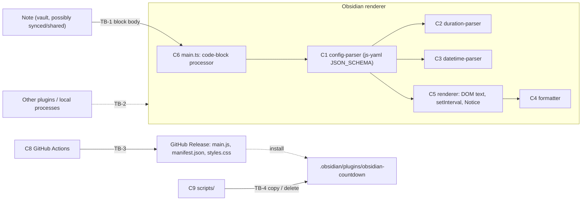

# Threat Model — Countdown Timer for Obsidian

| | |
|---|---|
| **Method** | STRIDE per component and trust boundary, backed by a targeted threat hunt. Every "Confirmed" finding was reproduced in this run with a small proof of concept (PoC); the PoC registry is summarised in §9 |
| **Version reviewed** | `1.2.18` (`manifest.json`) |
| **CODE_PIN** | `4c9642aacfcf5ed369254caee5a47d9c80369ee7` (`master` after the dependency updates and before this change; all `file:line` citations are against `src/` at this commit) |
| **Review date** | 2026-11-18 |
| **Mode** | CREATE (first model) |
| **Status** | Draft for review — not merged without maintainer approval |
| **Scope** | Plugin source (`src/`), build/CI/release (`.github/`, `esbuild.config.mjs`, `version-bump.mjs`), install and release scripts (`scripts/`). Out of scope: Obsidian itself, other plugins, and the user's vault sync/backup tooling |

---

## 1. How to use this document

**Purpose.** Engineers consult this before changing anything that parses note content, renders it, adds a network call or persisted state, or touches the release pipeline. It records what an attacker could do, what was actually demonstrated, and what is still open.

This plugin is deliberately small: no network access, no credentials, no persisted data, no remote content. Most of the risk therefore sits in (a) parsing text that anyone who can edit a note controls, and (b) the supply chain between this repository and the `main.js` that users install. The model reflects that.

### 1.1 When you MUST update it

| Change type | Re-read / update |
|---|---|
| Any change to how a ```` ```countdown ```` block is parsed (`yaml.load` options, new config keys, new date/duration syntax, new format codes) | D-1, D-2, V-1, V-2, V-3 |
| New **sink** that renders config text as markup (`innerHTML`, `MarkdownRenderer`, `createEl` with HTML, `Notice` with a `DocumentFragment`) | H-1, V-4 |
| New **network call**, remote asset, or URL built from note content | §2.2, V-5 |
| New **persisted data** (`loadData`/`saveData`, files written to the vault) | §2.1, V-6 |
| New timers, intervals, or event listeners in `renderTimer` / `main.ts` | D-3, V-7 |
| Any **CI, release, or build** change (workflows, esbuild config, `.npmrc`, `version-bump.mjs`) | E-1 … E-3, V-8, V-9 |
| Any change to `scripts/*.sh` / `scripts/*.ps1`, or to how `manifest.json`'s `id` is used | T-1, V-10 |
| New runtime **dependency** (anything bundled into `main.js`) or an upgrade of `js-yaml` | D-1, §5.4 |
| **Relaxing a control** listed in §6 | §6, §7 |

**PR rule.** Every PR description includes one line: `Threat model: no impact` or `Threat model: updated (IDs)`.

### 1.2 Rating scale (likelihood × impact)

| Rating | Meaning |
|---|---|
| **Critical** | Likely and leads to code execution or loss of user data with no unusual precondition |
| **High** | Either likely with serious impact, or serious impact with a precondition that is realistic for ordinary users |
| **Medium** | Serious impact but needs a precondition outside the plugin (e.g. a note from an untrusted source, a compromised pipeline), or moderate impact that is easily reached |
| **Low** | Limited impact, or needs several unlikely preconditions, or only affects a trusted-contributor path |

When impact is high but a precondition is required, the finding says so in "Who can exploit it".

### 1.3 Status vocabulary

`Confirmed` reproduced in this run with a PoC · `Reasoned` found by reading code, not exercised · `Mitigated` a control exists and was checked · `Accepted` inherited from the platform or a deliberate trade-off (owner named) · `Disproved` hypothesis tested and did not hold.

---

## 2. System overview

**What it is.** An Obsidian community plugin (desktop and mobile, `isDesktopOnly: false`) that registers a `countdown` Markdown code-block processor (`src/main.ts:12`). The block body is YAML (`title`, `target` or `duration`, optional `format`). The plugin parses it, then renders a title, a ticking display and, for duration timers, an Obsidian `Notice` when the timer reaches zero. A settings tab shows static help text and examples.

**What it is not.** It makes no network requests, reads and writes no files, has no credentials or API keys, and calls neither `loadData` nor `saveData`. `obsidian` is an external (provided by the host); the only bundled runtime dependency is `js-yaml`.

**Runtime context.** The plugin runs in Obsidian's renderer with the privileges of the Obsidian process; Obsidian does not sandbox community plugins (AS-1). Users install through BRAT or a GitHub release. Vaults are frequently synced or shared (Obsidian Sync, iCloud, git, Dropbox), so **note content is not always written by the person who opens it**.

### 2.1 Assets

| ID | Asset | Why it matters |
|---|---|---|
| A1 | Responsiveness and availability of the Obsidian renderer | A note that freezes or crashes Obsidian denies the user access to their whole vault until the note is removed |
| A2 | Integrity of the released `main.js`, `manifest.json`, `styles.css` | Every installer runs `main.js` with full Obsidian privileges (AS-1) |
| A3 | Integrity of the repository's release credentials (`GITHUB_TOKEN` with `contents: write`) | Lets an attacker publish a release users will install |
| A4 | The user's vault and plugin folder | Collateral damage from the install/uninstall scripts |
| A5 | Correctness of what the timer shows | Users rely on it to track deadlines; a wrong value is an integrity problem, not only cosmetic |

There are no confidentiality assets inside the plugin itself: it holds no secrets and sends nothing anywhere.

### 2.2 Adversaries

| ID | Adversary | Capability |
|---|---|---|
| X1 | Note author the victim does not control | Can place a ```` ```countdown ```` block in a note the victim opens: a shared/downloaded vault, a clipped web page, a pasted snippet, a collaborator's edit |
| X2 | Co-resident code: another Obsidian plugin or local process | Reads/writes vault files; same renderer privileges, so can already do anything this plugin can |
| X3 | Compromised upstream | Malicious npm package or release of `js-yaml`/build tooling; hijacked GitHub Action tag |
| X4 | Malicious or compromised contributor | Can land code/config or alter workflows via PR or stolen credentials |
| X5 | Attacker who controls a checkout of this repository (a poisoned fork or PR branch the user builds locally) | Controls `manifest.json` and `scripts/` content the maintainer then runs |

### 2.3 Components

| ID | Component | Files |
|---|---|---|
| C1 | Config parser (YAML → config) | `src/parsers/config-parser.ts` |
| C2 | Duration parser | `src/parsers/duration-parser.ts` |
| C3 | Date/time parser | `src/parsers/datetime-parser.ts` |
| C4 | Formatter (strftime-style) | `src/formatters/timer-formatter.ts` |
| C5 | Renderer (DOM, interval, `Notice`) | `src/components/timer-renderer.ts` |
| C6 | Plugin shell (processor registration, timer registry, unload) | `src/main.ts` |
| C7 | Settings tab (static help) | `src/components/settings-tab.ts` |
| C8 | Build / CI / release | `.github/workflows/*.yml`, `.github/dependabot.yml`, `esbuild.config.mjs`, `version-bump.mjs`, `.npmrc`, `package*.json` |
| C9 | Install / uninstall / release scripts | `scripts/*.sh`, `scripts/*.ps1` |

### 2.4 Data-flow diagram and trust boundaries

| ID | Trust boundary |
|---|---|
| TB-1 | Note content ↔ plugin: the code-block body is attacker-influenceable text (X1) |
| TB-2 | Plugin ↔ other plugins / local files (shared renderer, shared `.obsidian` folder) |
| TB-3 | Source → CI → GitHub release → installing user |
| TB-4 | Repository checkout → maintainer's shell (`scripts/`, `npm run`) |



### 2.5 Assumptions (verify when possible)

| ID | Assumption (not verified in this run) | Findings that depend on it |
|---|---|---|
| AS-1 | Obsidian runs community plugins unsandboxed with Node/Electron access on desktop | A2, X2 |
| AS-2 | Obsidian's `createEl({text})` and `setText` assign `textContent` (no HTML parsing) | H-1, V-4 |
| AS-3 | A single script in the renderer cannot be interrupted by Obsidian; a long synchronous parse freezes the UI until it returns or the renderer is killed | D-1 |
| AS-4 | The code-block post-processor runs again whenever Obsidian re-renders the note (switching edit/reading view, editing the note, reopening it) and Obsidian does not tell the plugin when a rendered block is discarded | D-3 |
| AS-5 | GitHub repository settings (branch protection on `master`, required reviews, default `GITHUB_TOKEN` permissions, tag protection) could not be queried; their state is unknown | E-1 … E-3 |
| AS-6 | `actions/checkout` and `actions/setup-node` tags are mutable; a commit SHA is not | E-1 |

---

## 3. STRIDE matrix

| Component | S | T | R | I | D | E |
|---|---|---|---|---|---|---|
| C1 Config parser | — | H-1 (disproved) | — | — | D-1 | — |
| C2 Duration parser | — | — | — | — | D-2 | — |
| C3 Date/time parser | — | — | — | — | — | — |
| C4 Formatter | — | H-4 (disproved) | — | — | D-2 | — |
| C5 Renderer | — | H-1 (disproved) | — | — | D-3 | — |
| C6 Plugin shell | — | — | — | — | D-3 | — |
| C7 Settings tab | — | — | — | — | — | — |
| C8 Build/CI/release | — | E-3 | — | — | — | E-1, E-2 |
| C9 Scripts | — | T-1 | — | — | — | — |

Repudiation and information disclosure have no findings: the plugin keeps no logs, stores nothing and sends nothing (see §5.2).

---

## 4. Confirmed findings

Each finding was reproduced in this run unless marked otherwise; see §9 for the PoC summary. Environment for all unit-level PoCs: Linux 6.18, Node 22.23, `js-yaml` 4.3.2 (D-1 and the H-2/H-3 checks were also run on 4.1.1 with the same result), run directly against the built parser/formatter modules. Results may differ in Obsidian's real runtime.

### D-1 — YAML aliases let a tiny block expand into a huge string (`String()` amplification)

| | |
|---|---|
| **Rating** | Medium (impact: renderer freeze/crash; needs a note from X1) |
| **STRIDE** | Denial of service |
| **Status** | Confirmed (PoC-1) |
| **Where** | `src/parsers/config-parser.ts:24` (`yaml.load`), then `:40`, `:68`, `:77`, `:86` (`String(rawConfig.<key>)` on values that may be arrays/objects) |

**What happens.** `js-yaml` resolves anchors/aliases by *reference*, so a few hundred bytes can describe a nested array whose string form is exponentially large. `JSON_SCHEMA` does not prevent arrays or aliases. `parseConfig` then calls `String()` on the value, which flattens every reference. The result is also pushed into the DOM as the timer title (`timer-renderer.ts:24-27`).
**Who/impact.** Anyone who can get a countdown block into a note the victim opens. Each extra level of nesting multiplies the output by the fan-out (10× in the PoC). A 294-byte block produced a 2 MB string in 34–50 ms; the cost grows geometrically, so a block of a few hundred bytes reaches gigabytes at roughly depth 9, which freezes or crashes the renderer (AS-3). Because the block is re-parsed every time the note renders, the user may be unable to open the note, or Obsidian, again without editing the file outside Obsidian.
**Evidence.** PoC-1, depths 3→6: 2 KB → 20 KB → 200 KB → 2 MB output from 144 → 294 bytes of input. Larger depths were deliberately not run. Re-run on `js-yaml` 4.3.2 (which adds `maxDepth` and merge-key limits) gave the same result: the expansion happens in the plugin's `String()` call, not in the parser, so the upgrade does not help.
**Recommendation.** R-1.

### D-2 — Unbounded duration, and non-finite values, produce a timer that never completes and shows `Infinityd NaNh NaNm NaNs`

| | |
|---|---|
| **Rating** | Low |
| **STRIDE** | Denial of service / integrity of displayed data (A5) |
| **Status** | Confirmed (PoC-2) |
| **Where** | `src/parsers/duration-parser.ts:48,75` (`parseInt` of arbitrarily many digits, unbounded multiply/sum); `src/components/timer-renderer.ts:56` (`Date.now() + config.duration`); `src/formatters/timer-formatter.ts:14-28` |

**What happens.** A duration like `99999999999999999999d` parses as valid (8.64e27 ms). Beyond about `100000000d` the resulting `Date` is invalid; with ~310+ digits `parseInt` returns `Infinity` and the formatter prints `Infinityd NaNh NaNm NaNs`. Remaining time is `NaN`, `NaN <= 0` is false, so the timer never reaches "complete" and never raises a `Notice`.
**Who/impact.** X1, or an honest typo. No crash; the timer shows nonsense and silently never fires. Low because the user can see it is wrong.
**Evidence.** PoC-2: `parseDuration` returned `valid: true` for all four inputs tried; `new Date(Date.now()+ms)` was invalid for each.
**Recommendation.** R-2.

### D-3 — Timers are never stopped when a rendered block is discarded; the registry only grows

| | |
|---|---|
| **Rating** | Low |
| **STRIDE** | Denial of service (slow resource leak) |
| **Status** | Reasoned (AS-4) |
| **Where** | `src/main.ts:7,41` (`activeTimers.push`, no removal), `:18-21` (only cleared on unload); `src/components/timer-renderer.ts:96-102` (`window.setInterval` stopped only through `stop()`) |

**What happens.** Every time the post-processor runs (each render of a note containing a countdown block) a new 1-second interval is started and a handle appended to `activeTimers`. Nothing ties the interval's lifetime to the rendered element, so intervals for elements that are no longer in the document keep running, each calling `updateDisplay` and `formatTimeRemaining` once a second, until the plugin is unloaded.
**Who/impact.** A note with many blocks (X1 can add hundreds), edited or re-rendered many times in a long session, accumulates timers; CPU and memory grow slowly. Duration timers that complete also call `new Notice` once per timer, so a note with many short duration blocks produces a burst of notices. This is a resource-hygiene issue more than an attack, hence Low.
**Evidence.** Code reading only; not exercised in a real Obsidian instance.
**Recommendation.** R-3.

### T-1 — `uninstall.sh` / `uninstall.ps1` delete whatever directory `manifest.json`'s `id` points at (fixed in this change)

| | |
|---|---|
| **Rating** | Low as shipped here (Medium in the unhardened form this script was ported from) |
| **STRIDE** | Tampering (A4) |
| **Status** | Confirmed (PoC-3) on the unhardened script; **Mitigated** in the committed scripts |
| **Where** | `scripts/uninstall.sh` and `scripts/uninstall.ps1` (plugin id read from `manifest.json`, joined onto `<vault>/.obsidian/plugins/`, then `rm -rf` / `Remove-Item -Recurse -Force`); `install.sh` / `install.ps1` use the same id for `mkdir -p` / `New-Item` |

**What happens.** In the unhardened version, `"id": "../../precious"` made the script remove `<vault>/precious`. The scripts only checked that the id was a non-empty string.
**Who/impact.** X5: a maintainer who builds and runs the scripts from an untrusted checkout (a PR branch, a fork). Such a checkout can already run arbitrary code through `npm run build`, so the incremental impact is small, but a recursive delete driven by a data file is the kind of thing that should not rely on that.
**Evidence.** PoC-3: with a throwaway vault, the unhardened script deleted the sibling directory; the hardened script exits with `manifest.json is missing a valid plugin id` and removes nothing, and still uninstalls a legitimately named plugin.
**Mitigation shipped.** The id must match `^[A-Za-z0-9][A-Za-z0-9._-]*$` and must not contain `..`, in all four scripts. The PowerShell scripts could not be executed in this environment (no `pwsh`); the same check was added there but is **untested** (see §5.3 / V-10).
**Recommendation.** Keep the check; add a CI shell test (R-6).

### E-1 — Third-party GitHub Actions: pinned by commit SHA, with Dependabot to keep them current

| | |
|---|---|
| **Rating** | Low (was Medium before this change: `actions/checkout@v4` and `actions/setup-node@v4` were mutable tags) |
| **STRIDE** | Elevation of privilege (X3) |
| **Status** | Mitigated |
| **Where** | `.github/workflows/ci.yml`, `.github/workflows/release.yml`, `.github/dependabot.yml` |

**What happens.** A moved or hijacked tag would run attacker code in the release job, which holds `contents: write` (A3). The workflows now pin each action to a full commit SHA (with the version in a comment), set `persist-credentials: false` on checkout, give CI `contents: read` only, and Dependabot tracks the `github-actions` ecosystem weekly so the pins do not go stale.
**Residual.** Dependabot PRs that move a SHA still need a human to look at what changed. The SHAs were taken from a sibling repository maintained by the same owner and were not independently re-verified against the upstream tags in this run (AS-6).
**Recommendation.** R-4.

### E-2 — Release job builds code and holds a write token in the same job; no provenance on artifacts

| | |
|---|---|
| **Rating** | Medium (needs a compromised dependency/contributor; impact: users install a malicious `main.js`) |
| **STRIDE** | Elevation of privilege (A2, A3) |
| **Status** | Reasoned |
| **Where** | `.github/workflows/release.yml` (job `permissions: contents: write`; `npm ci`, `npm run build` and `gh release create` all in one job) |

**What happens.** The token is only exposed as an environment variable to the final `gh release create` step, `npm ci --ignore-scripts` and `.npmrc` `ignore-scripts=true` stop install-time scripts, and checkout does not persist the credential, so a compromised dependency cannot trivially read it. But the job that holds `contents: write` is also the job that runs `npm run build`, so code executed during the build (esbuild, TypeScript, a compromised dev dependency) runs next to a job-scoped token, and it is the same job that produces the artifact it publishes. Nothing proves to a user that a released `main.js` came from this workflow either (no `actions/attest-build-provenance`, no published checksums).
**Who/impact.** X3/X4. Realistic only through a supply-chain compromise or a merged malicious PR.
**Recommendation.** R-5.

### E-3 — Release is triggered by any push to `master` that touches `manifest.json`; branch protection unknown

| | |
|---|---|
| **Rating** | Low–Medium (depends on AS-5) |
| **STRIDE** | Tampering / Elevation of privilege |
| **Status** | Reasoned |
| **Where** | `.github/workflows/release.yml` (`on.push.branches: [master]`, `paths: [manifest.json]`) |

**What happens.** Anyone who can push to `master` (or merge a PR) with a new `manifest.json` version publishes a release; `gh release create` tags the current `master` HEAD. If `master` is not protected, a stolen maintainer credential is enough to ship code to every user without review. Conversely, a dependency-only change that does not bump `manifest.json` does **not** publish a release; that is the reason the Dependabot PRs in this repository are given a patch bump.
**Recommendation.** R-4.

---

## 5. Full register

### 5.1 By STRIDE letter

#### Spoofing
None identified. There is no authentication, identity, or callback surface.

#### Tampering
| ID | Title | Status | Rating |
|---|---|---|---|
| H-1 | Config text rendered as HTML | Disproved | — |
| H-4 | Format-string placeholder collision changes output | Disproved (cosmetic only) | — |
| T-1 | Uninstall scripts delete a path chosen by `manifest.json`'s `id` | Confirmed → Mitigated | Low |
| E-3 | Release trigger and branch protection | Reasoned | Low–Medium |

#### Repudiation
None. No logging, no actions on the user's behalf.

#### Information disclosure
None. No network, storage, secrets or logging (§5.2).

#### Denial of service
| ID | Title | Status | Rating |
|---|---|---|---|
| D-1 | YAML alias amplification via `String()` | Confirmed | Medium |
| D-2 | Unbounded / non-finite durations never complete | Confirmed | Low |
| D-3 | Interval/registry leak when blocks are discarded | Reasoned | Low |

#### Elevation of privilege
| ID | Title | Status | Rating |
|---|---|---|---|
| E-1 | Mutable action tags | Mitigated | Low |
| E-2 | Build and write token in one job; no provenance | Reasoned | Medium |
| E-3 | see Tampering | | |
| E-4 | Dependency vulnerabilities in dev tooling reach the build | Accepted | Low (§5.4) |

### 5.2 Privileged-sink inventory (grep results at CODE_PIN)

| Sink class | Result |
|---|---|
| `innerHTML` / `outerHTML` / `insertAdjacentHTML` / `dangerouslySetInnerHTML` / `document.write` / `srcdoc` / `eval` / `new Function` / `postMessage` / `window.open` / `MarkdownRenderer` / `child_process` in `src/` | **None** |
| Network (`fetch`, `requestUrl`, `XMLHttpRequest`, `WebSocket`, ``, `<iframe>`, `<a href>`) in `src/` | **None** |
| Persistence (`loadData`, `saveData`, `vault.*`, `localStorage`, file writes) in `src/` | **None** |
| `require('electron')` / `shell.openExternal` / protocol handler | **None** |
| `new Notice(...)` | 1 — `timer-renderer.ts:88`, argument is a template string containing `config.title`; `Notice` with a string sets text, not HTML (AS-2) |
| `container.createEl(..., {text})` / `setText` with config-derived values | 8 — `timer-renderer.ts:24,46,62,77,81,114` (title, target date, error text, formatted time, status); the remaining `createEl` calls (`:29,33`) set only a class; all use the `text` option / `setText`, never `innerHTML` |
| `window.setInterval` | 1 — `timer-renderer.ts:96` (see D-3) |
| `yaml.load` | 1 — `config-parser.ts:24`, `schema: yaml.JSON_SCHEMA` |
| `new RegExp(...)` built from input | 1 — `timer-formatter.ts:84`, but the pattern is a constant placeholder, not user input |

### 5.3 Hypotheses tested and disproved

| ID | Hypothesis | Result |
|---|---|---|
| H-1 | A `title` or `format` containing `` or other HTML becomes live markup | **Disproved** by sink inventory (§5.2): everything goes through `text`/`setText`; unit tests exist for rendering. Depends on AS-2 |
| H-2 | YAML custom tags (`!!js/function`, `!!python/…`) execute code or construct objects | **Disproved** (PoC-4): `js-yaml` 4 rejects unknown tags (`unknown tag !<tag:yaml.org,2002:js/function>`), and `JSON_SCHEMA` has no extended types |
| H-3 | A `__proto__` key in the block pollutes `Object.prototype` or changes config lookups | **Disproved** (PoC-4): `js-yaml` 4 creates an own property; `({}).polluted` stayed `undefined` and `rawConfig.title` lookups were unaffected |
| H-4 | A `format` containing the literal NUL-delimited placeholder (`\0PERCENT\0`) breaks substitution or leaks data | **Disproved as a security issue**: the placeholder is only ever turned into `%`; the worst result is a cosmetic `%` in the output |
| H-5 | A non-string `title` (object/array) is rendered unsafely | **Disproved**: `String({a:'b'})` renders as the text `[object Object]`; the only danger is size (D-1) |
| H-6 | Regular expressions in the date parser are vulnerable to catastrophic backtracking | **Not found** at review depth (patterns are anchored and use bounded quantifiers); not fuzzed — recorded under §10 as unverified |
| H-7 | The PowerShell scripts reject a traversal id | **Untested**: no `pwsh` available in this environment (see T-1) |

### 5.4 Dependency posture (dated 2026-11-18 — expected to change)

| Item | State at CODE_PIN |
|---|---|
| Runtime dependencies bundled into `main.js` | One: `js-yaml` 4.3.2. `obsidian` is external (provided by the host) |
| `npm audit --omit=dev` | **0 vulnerabilities** |
| `npm audit` (including dev tooling) | 50 reported (1 low, 12 moderate, 37 high), all in the dev/test toolchain (Jest, ESLint/typescript-eslint and their transitive deps). Root advisories: `picomatch` ReDoS (extglobs), `minimatch` DoS, `glob` AbortSignal bypass, `ajv` `$data` ReDoS, `@babel/core` sourceMappingURL file read. Most of the 50 are the same few advisories propagated up the Jest dependency chain |
| Reachability | None of these packages is shipped in `main.js`. They run only on a developer machine or in CI, on repository-controlled inputs (globs, configs, source maps). The realistic exposure is a malicious PR changing those inputs (X4), which §6's CI controls already assume |
| Install scripts | `npm ci --ignore-scripts` in all workflows plus `.npmrc` `ignore-scripts=true` |
| Update flow | Dependabot (npm and github-actions, weekly). Dependabot keeps opening new PRs as lockfile changes land, so this row goes stale quickly; re-run `npm audit` when reviewing |
| Gap | `npm audit` is not a CI step, so a new advisory on a *runtime* dependency is only noticed when Dependabot opens a PR (see R-8) |

---

## 6. Existing controls inventory

| Control | Location | Protects |
|---|---|---|
| `yaml.load` with `schema: yaml.JSON_SCHEMA` (no custom tags, no implicit timestamps) | `config-parser.ts:24` | H-2, date-handling surprises |
| Parser results are discriminated unions (`valid: true/false`); invalid input renders an error box, not an exception | `src/types.ts`, `main.ts:28-31` | Crashes from malformed input |
| Duration grammar is a strict regex (`^(\d+[dhms])+$`), duplicate/out-of-order units rejected | `duration-parser.ts:30-61` | Malformed durations (not their magnitude — see D-2) |
| All config-derived text goes through `text:` / `setText` | `timer-renderer.ts` | H-1, markup injection |
| Timers are stopped on plugin unload | `main.ts:17-22` | Leaks across plugin disable (not across re-render — D-3) |
| `eslint-plugin-obsidianmd` recommended rules, `typescript-eslint`, strict `tsc` | `eslint.config.js`, `tsconfig.json` | Obsidian-API misuse, unsafe patterns |
| Unit tests for parsers, formatter, renderer, settings tab | `tests/` | Regressions in V-1…V-4 behaviours |
| CI uses `pull_request` (not `pull_request_target`); `contents: read` | `ci.yml` | Fork-secret exposure |
| Actions pinned to commit SHAs; `persist-credentials: false` | workflows | E-1 |
| `npm ci --ignore-scripts` plus `.npmrc` `ignore-scripts=true` | workflows, `.npmrc` | Install-time script execution (E-2) |
| Lockfile enforced in CI and release (`npm ci`) | workflows | Reproducible installs |
| Dependabot (npm and github-actions, weekly) | `.github/dependabot.yml` | Stale dependencies |
| Plugin-id allow-list in install/uninstall scripts | `scripts/*.sh`, `scripts/*.ps1` | T-1 |

---

## 7. Security invariants (regression-test targets)

| ID | Invariant | State |
|---|---|---|
| V-1 | `parseConfig` finishes in bounded time and memory for any input of a given length, including YAML with aliases | **VIOLATED** (D-1) |
| V-2 | A parsed duration is finite and below a sane maximum, or is rejected with an error | **VIOLATED** (D-2) |
| V-3 | Only `title`, `target`, `duration`, `format` are read from the block; unknown keys are ignored | **Holds** (code); no test for `__proto__` yet |
| V-4 | No config-derived string is rendered as HTML or used as a URL | **Holds** (§5.2) |
| V-5 | The plugin makes no network requests | **Holds** (§5.2); not enforced by a test |
| V-6 | The plugin persists nothing and stores no secrets | **Holds** (§5.2); not enforced by a test |
| V-7 | Every interval started by `renderTimer` is stopped when its element is discarded or the plugin unloads | Unload **Holds**; element removal **VIOLATED** (D-3) |
| V-8 | Release artifacts are built only from reviewed `master` code with minimal-scope credentials and have provenance | **Partly enforced**: SHA-pinned actions, no persisted credentials, `ignore-scripts`; provenance and branch protection **Not enforced** (E-2, E-3) |
| V-9 | Workflows never use `pull_request_target` with untrusted checkout, and grant least privilege per job | **Holds** |
| V-10 | The install/uninstall scripts only touch `<vault>/.obsidian/plugins/<valid-id>` and `community-plugins.json` | **Holds** for the shell scripts (PoC-3); PowerShell **untested** (H-7) |

---

## 8. Recommendations (ordered by risk reduced per effort)

| ID | Recommendation | Effort | Closes |
|---|---|---|---|
| R-1 | In `config-parser.ts`, only coerce scalar values: reject any `title`/`target`/`duration`/`format` that is not a string, number or boolean *before* calling `String()`; consider a small cap on `input.length` (e.g. 10 KB) and on title length. Upgrading `js-yaml` does not fix this (verified on 4.3.2) | S | D-1, V-1 |
| R-2 | In `parseDuration`, reject values above a documented maximum (e.g. 100 years) and results that are not `Number.isFinite`; in `renderTimer`, treat `Number.isNaN(targetTime)` as an invalid configuration | S | D-2, V-2 |
| R-3 | Stop timers when their element is gone: use `MarkdownRenderChild` (`ctx.addChild`) so `onunload` calls `stop()`, and remove the handle from `activeTimers`; or have `updateDisplay` stop itself when `!container.isConnected` | M | D-3, V-7 |
| R-4 | Enable branch protection on `master` (require PR + CI, restrict who can push), consider tag protection, and review Dependabot SHA bumps | S | E-1, E-3 |
| R-5 | Split release into a build job (read-only) and a publish job (write token, downloads the artifact); add `actions/attest-build-provenance` and publish `SHA256SUMS` | M | E-2, V-8 |
| R-6 | Add a small CI job (or a Jest test) that runs `scripts/uninstall.sh` against a temp vault with a hostile `manifest.json` id, and run the PowerShell scripts once under `pwsh` | S | T-1, V-10, H-7 |
| R-7 | Add tests for the invariants marked "not enforced by a test" (V-3 `__proto__`, V-5/V-6 via a grep-style test of `src/`) | S | V-3, V-5, V-6 |
| R-8 | Add `npm audit --omit=dev --audit-level=high` as a CI job so runtime-dependency advisories fail the build | S | §5.4 gap, E-4 |

---

## 9. PoC registry

All PoCs are local, use fake data, and were run against the built modules or throwaway directories. Nothing was run against third-party hosts. Sizes were bounded.

| ID | Target | Method | Result |
|---|---|---|---|
| PoC-1 | D-1 | `js-yaml.load(src, {schema: JSON_SCHEMA})` on a block that defines `&a0` as a list of 10 items and each `&aN` as a list of ten `*a(N-1)` aliases, then `String(parsed.target)` | depth 3: 144 B → 2 KB; 4: 194 B → 20 KB; 5: 244 B → 200 KB; 6: 294 B → 2 MB in 34 ms. Growth is ×10 per level. Deeper levels not run |
| PoC-2 | D-2 | `parseDuration` + `formatTimeRemaining` on `99999999999999999999d`, a 400-digit `…d`, `106751991167d`, `100000000d` | all `valid: true`; `new Date(Date.now()+ms)` invalid for all four; the 400-digit case prints `Infinityd NaNh NaNm NaNs` |
| PoC-3 | T-1 | Throwaway repo copy with `manifest.json` `{"id":"../../precious"}` and a vault containing `precious/`; run `uninstall.sh` | Unhardened: `precious/` removed. Hardened: exit 1, `manifest.json is missing a valid plugin id`, nothing removed; with `{"id":"obsidian-countdown"}` the plugin folder is removed as intended |
| PoC-4 | H-2, H-3, H-5 | `yaml.load` with `!!js/function`, a `__proto__` mapping, and `title: {a: b}` | tag rejected; no prototype pollution; renders `[object Object]` |

---

## 10. Claims register

| Claim | Source | Verdict |
|---|---|---|
| "Use JSON_SCHEMA to disable automatic date parsing" | `config-parser.ts:21-23` | **Verified** — also removes custom tags (PoC-4) |
| "Should not happen due to validation, but handle gracefully" (`Invalid configuration` branch) | `timer-renderer.ts:60` | **Unverified** for non-finite durations: `NaN` passes the guard (D-2) |
| "Prevents multiple notifications when updateDisplay is called repeatedly" | `timer-renderer.ts:69` | **Verified** for finite timers; never fires for `NaN` timers (D-2) |
| "Track for cleanup when plugin unloads" | `main.ts:40` | **Verified** for unload; does not cover element removal (D-3) |
| "All parsers return discriminated unions" | `CONTRIBUTING.md` | **Verified** by types; D-1 is an input-size problem, not a typing one |
| Date-parser regexes are not vulnerable to ReDoS | — | **Unverified** (H-6) |
| PowerShell scripts validate the plugin id the same way | this change | **Unverified** (H-7) |
| GitHub branch protection / token defaults are restrictive | — | **Unverified** (AS-5) |

---

## 11. Review log (append-only)

| Date | CODE_PIN | Mode | Reviewer | Summary |
|---|---|---|---|---|
| 2026-11-18 | `4c9642aacfcf5ed369254caee5a47d9c80369ee7` (v1.2.18) | CREATE | Claude Code (for @mpfilbin) | Initial model, produced in the same change that ports the install/release scripts and the CI/release workflows. 3 Confirmed (D-1, D-2, T-1), 3 Reasoned (D-3, E-2, E-3), 1 Mitigated (E-1), 1 Accepted (E-4), 6 hypotheses disproved or not found. No plugin source changed; `scripts/uninstall.*`/`install.*` were hardened (T-1). |
